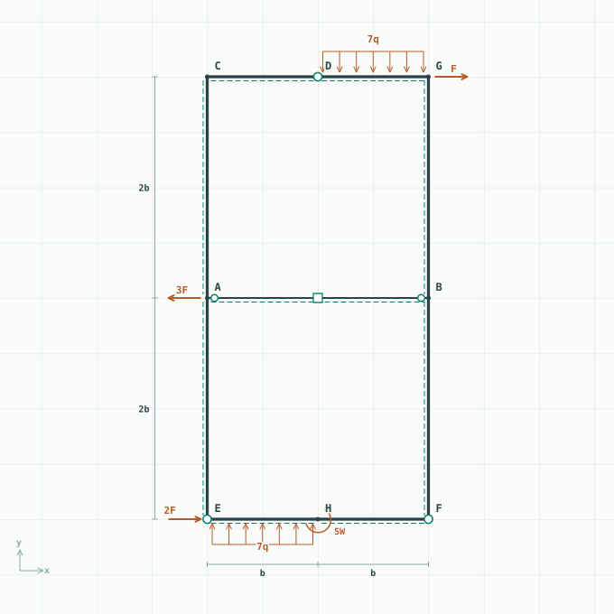
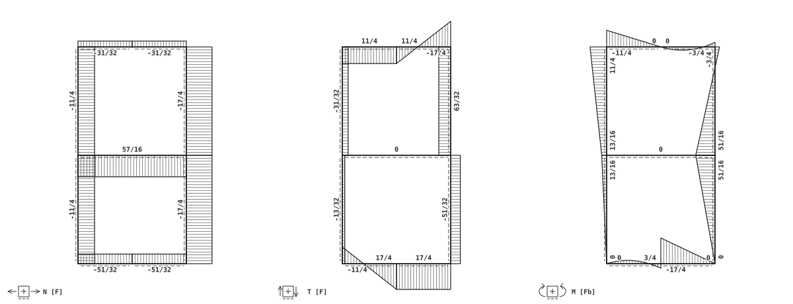

[🇮🇹 Italiano](README.md) · **🇬🇧 English**

# TrussSolver

Draw a plane structure like the one on your exam sheet, press **Solve** and get the full worked solution by the force method: the N, T and M diagrams, the value of the redundant unknown and every step of the virtual work calculation.

It is made for engineering students who want to check their own work step by step. It is free, runs in the browser and needs no installation.

| The scheme you draw | The diagrams you get |
| --- | --- |
|  |  |

## Getting started

1. **Download.** On this page press **Code → Download ZIP** and extract the folder.
2. **Open.** Double-click `index.html`. It opens in your browser and also works offline.
3. **Try it.** Exam 1 is already solved when the page opens. The **Models** menu holds the other ready-made exams.

Choose the language, **Italiano** or **English**, at the top right. The page starts in Italian.

## Solving an exam in six steps

Choose **Models → New drawing** and follow the order of the exam sheet.

1. **Nodes.** With **Node** click the grid at every lettered point. One grid square is half a b. Then select each node and type the letter it has on the sheet in the **Name** field.
2. **Members.** With **Member** click the first and then the second node, in the order of the member name: for member CA click C first, then A.
3. **Supports.** Select the node and choose the **Support type**.
4. **Hinges, sliders and internal rollers.** Select the member and in **Connections to the nodes** choose how it is attached at each end.
5. **Loads.** Forces and couples on the nodes, distributed load and thermal effects on the members.
6. **Solve.** In **Whole model** choose the unknown named on the sheet, then press **Solve**.

**Select** is for editing, **Pan** moves the board, the curved arrow undoes. **Save** downloads the drawing and **Open** loads it again.

## From the exam sheet to the editor

| On the sheet | Where it goes |
| --- | --- |
| Roller, pinned support, fixed support, double pendulum | Node → **Support type** |
| Circle centred on a node: hinge between the members | Member → **Connections to the nodes** → Hinge |
| Slider: two short bars across the member, or a U-shaped sleeve | Member → **Connections to the nodes** → Slider |
| Roller between two members, also with “Plane 1:1” | Member → **Connections to the nodes** → Roller. For the 1:1 plane type Δx = 1 and Δy = 1 |
| Double circle with k = 3EJ/b: rotational spring | Member → **Rotational springs at the ends** → `3` |
| Spring under a support, settlement v = 3δ | Node → **Support springs and settlements** |
| H_A = −3F, V_A, W_A | Node → **Nodal loads** → `-3` |
| H_BA, W_CF: loads on one specific member | Member → **Loads on one side of the node** |
| q_AB = −q, p_AB | Member → **Uniform load**: q along y, p along x |
| ε = −b²F/EJ, small square on the member | Member → **Imposed strains** → ε = `-1` |
| θ = −bF/EJ, small trapezium on the member | Member → **Imposed strains** → θ = `-1` |
| X = W_BC | **Whole model → Unknown to release** |
| Cross-section, b in mm and F in N | **Whole model → Cross-section and stresses** |

## How to type the numbers

Type only the coefficient written on the sheet: the units are already F, b and EJ.

| On the sheet | In the field |
| --- | --- |
| H = −3F | `-3` |
| W = 5Fb | `5` |
| q = −7F/b | `-7` |
| k = 3EJ/b | `3` |
| length 2b | coordinates that are `2` apart |

Every member of the exams has stiffness EJ, that is `1`, already set. You can type fractions such as `3/2` or decimals such as `1.5`. Results are fractions: **Show decimals** turns them into numbers.

## Reading the results

| Tab | What you find |
| --- | --- |
| **Internal forces** | The N, T and M diagrams of the final, primary and unit-load structures. Below, the equations N(x), T(x) and M(x) of the member you choose |
| **Reactions** | Every member isolated with the forces at its ends, and the support reactions |
| **Equilibrium** | The system of equilibrium equations |
| **Virtual work** | Released structure, M₀ and Mₓ diagrams, virtual work table, worked integrals and the value of X |
| **Cross-section** | Centroid, moments of inertia and the stresses σ, τ and von Mises |

The **dashed line** beside each member marks the side in tension for a positive moment. At first it is on the right of someone walking along the member from its first to its second letter, as on the exam sheets.

## If something looks wrong

| What you see | What to check |
| --- | --- |
| “Statically indeterminate · degree 2” but the sheet has one redundant | A hinge is missing. A circle centred on the node is a hinge between the members, even with a roller underneath |
| “The structure is a mechanism” | A support is missing, there is one hinge too many, or the slider is on the wrong member |
| “Singular compatibility” | The unknown works axially only: tick **Include axial deformability** |
| Signs opposite to the published solution | Member direction, dashed side or sign of θ. The direction comes from the name: CA starts at C |
| Unknowns named differently from the sheet | Rename the nodes with the letters of the sheet |
| Long fractions that are hard to read | Turn on **Show decimals** |

## Ready-made exams

Five exams are already entered and checked against the published solutions. Each has a step-by-step guide.

| Exam | What it contains | Result |
| --- | --- | --- |
| [Exam 1](tutorial/01-telaio-con-biella/README.en.md) | Frame without supports, bar with thermal elongation | W_AE = −13/16 Fb |
| [Exam 2](tutorial/02-telaio-con-molla/README.en.md) | Internal roller on an inclined plane, rotational spring | W_FD = 31/42 Fb |
| [Exam 8](tutorial/08-doppio-pendolo-e-molla/README.en.md) | Double pendulum, translational spring, thermal curvature | W_BC = −553/264 Fb |
| [Exam 11](tutorial/11-pattini-interni/README.en.md) | Internal sliders, loads on one side of the node | W_AD = 39/31 Fb |
| [Exam 13](tutorial/13-cedimento-imposto/README.en.md) | Imposed settlement, member √5 b long | V_G = −59/8 F |

The [tutorial index](tutorial/README.en.md) explains how to read schemes and signs.

## What it computes and what it does not

Elastic plane frames with straight members, solved by the force method and the principle of virtual work. Bending, thermal effects, springs and settlements are included. Axial deformability is optional and is off in the exams.

Varying distributed loads, inclined supports and non-symmetric cross-sections are not covered.

## Free for everyone

TrussSolver is free, and anyone can use it and share it. If it helped you and you feel like it, you can [buy me a coffee ☕](https://www.paypal.com/paypalme/mattiagottiii).

## For those who want to look at the code

The project is plain JavaScript, with no packages to install.

| File | What it does |
| --- | --- |
| [src/solver.js](src/solver.js) | Equilibrium, constraints, virtual work and compatibility |
| [src/examples.js](src/examples.js) | The exams in the Models menu |
| [src/section.js](src/section.js) | Cross-section and stresses |
| [src/numbers.js](src/numbers.js) | Fractions, roots and decimals |
| [src/i18n.js](src/i18n.js) | English texts |
| [src/drawing.js](src/drawing.js) and [src/navigation.js](src/navigation.js) | Drawing, diagrams and zoom |
| [src/report.js](src/report.js) and [src/app.js](src/app.js) | Result tabs and editor |

With Node.js 18 or later the tests run from the project folder:

```sh
node --test
```

They compare the solver with analytic cases and the five exams with the published solutions.
