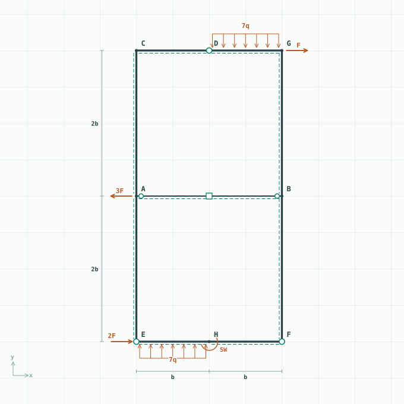
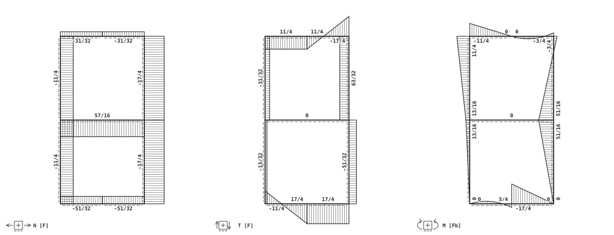

**🇮🇹 Italiano** · [🇬🇧 English](README.en.md)

# TrussSolver

Disegni una struttura piana come quella della traccia d’esame, premi **Calcola** e ottieni lo svolgimento completo con il metodo delle forze: i diagrammi N, T e M, il valore dell’incognita iperstatica e tutti i passaggi dei lavori virtuali.

È pensato per studenti di ingegneria che vogliono controllare i propri conti passo per passo. È gratuito, funziona nel browser e non richiede installazioni.

| Lo schema che disegni | I diagrammi che ottieni |
| --- | --- |
|  |  |

## Come iniziare

1. **Scarica.** In questa pagina premi **Code → Download ZIP** ed estrai la cartella.
2. **Apri.** Fai doppio clic su `index.html`. Si apre nel browser e funziona anche senza internet.
3. **Prova.** All’avvio trovi il tema 1 già risolto. Dal menu **Modelli** puoi aprire gli altri temi pronti.

In alto a destra scegli la lingua, **Italiano** o **English**.

## Risolvere un tema in sei passi

Scegli **Modelli → Nuovo disegno** e segui l’ordine della traccia.

1. **Nodi.** Con **Nodo** tocca la griglia nei punti con una lettera. Un quadretto vale mezzo b. Poi seleziona ogni nodo e scrivi nel campo **Nome** la lettera che ha sulla traccia.
2. **Aste.** Con **Asta** tocca il primo e poi il secondo nodo, nell’ordine del nome dell’asta: per l’asta CA tocca prima C e poi A.
3. **Vincoli a terra.** Seleziona il nodo e scegli il **Tipo di appoggio**.
4. **Cerniere, pattini e carrelli interni.** Seleziona l’asta e in **Collegamenti ai nodi** scegli come si attacca a ciascun estremo.
5. **Carichi.** Forze e coppie sui nodi, carico distribuito ed effetti termici sulle aste.
6. **Calcola.** In **Modello completo** scegli l’incognita indicata dalla traccia, poi premi **Calcola**.

**Seleziona** serve per modificare, **Mano** per spostare la tavola, la freccia curva per annullare. **Salva** scarica il disegno e **Apri** lo ricarica.

## Dalla traccia all’editor

| Sulla traccia | Dove si inserisce |
| --- | --- |
| Carrello, cerniera a terra, incastro, doppio pendolo | Nodo → **Tipo di appoggio** |
| Cerchio centrato su un nodo: cerniera fra le aste | Asta → **Collegamenti ai nodi** → Cerniera |
| Pattino: due trattini sull’asta o manicotto a U | Asta → **Collegamenti ai nodi** → Pattino |
| Carrello fra due aste, anche con «Piano 1:1» | Asta → **Collegamenti ai nodi** → Carrello. Per il piano 1:1 scrivi Δx = 1 e Δy = 1 |
| Doppio cerchio con k = 3EJ/b: molla rotazionale | Asta → **Molle rotazionali agli estremi** → `3` |
| Molla sotto un vincolo, cedimento v = 3δ | Nodo → **Molle e cedimenti del vincolo** |
| H_A = −3F, V_A, W_A | Nodo → **Carichi nodali** → `-3` |
| H_BA, W_CF: carichi su un’asta precisa | Asta → **Carichi su un solo lato del nodo** |
| q_AB = −q, p_AB | Asta → **Carico uniforme**: q lungo y, p lungo x |
| ε = −b²F/EJ, quadratino sull’asta | Asta → **Deformazioni impresse** → ε = `-1` |
| θ = −bF/EJ, trapezio sull’asta | Asta → **Deformazioni impresse** → θ = `-1` |
| X = W_BC | **Modello completo → Incognita da rilasciare** |
| Sezione, b in mm e F in N | **Modello completo → Sezione e tensioni** |

## Come si scrivono i numeri

Si scrive solo il coefficiente che compare sulla traccia: le unità sono già F, b ed EJ.

| Sulla traccia | Nel campo |
| --- | --- |
| H = −3F | `-3` |
| W = 5Fb | `5` |
| q = −7F/b | `-7` |
| k = 3EJ/b | `3` |
| lunghezza 2b | coordinate che distano `2` |

Tutte le aste dei temi hanno rigidezza EJ, cioè `1`, già impostata. Puoi scrivere frazioni come `3/2` oppure decimali come `1,5`. I risultati sono frazioni: con **Mostra decimali** diventano numeri.

## Leggere i risultati

| Scheda | Che cosa trovi |
| --- | --- |
| **Azioni interne** | I diagrammi N, T e M della struttura finale, della principale e di servizio. Sotto, le equazioni N(x), T(x) e M(x) dell’asta che scegli |
| **Reazioni** | Ogni asta isolata con le forze ai suoi estremi, e le reazioni dei vincoli |
| **Equilibrio** | Il sistema delle equazioni di equilibrio |
| **Lavori virtuali** | Schema di calcolo, diagrammi M₀ e Mₓ, quadro dei contributi del PLV, integrali svolti e valore di X |
| **Sezione** | Baricentro, momenti d’inerzia e tensioni σ, τ e von Mises |

Il **tratteggio** accanto a ogni asta indica il lato teso per momento positivo. All’inizio sta a destra di chi percorre l’asta dalla prima alla seconda lettera, come sulle tracce.

## Se qualcosa non torna

| Che cosa vedi | Che cosa controllare |
| --- | --- |
| «Iperstatica · grado 2» ma la traccia ne ha una sola | Manca una cerniera. Un cerchio centrato sul nodo è una cerniera fra le aste, anche se sotto c’è un carrello |
| «Struttura labile» | Manca un vincolo, c’è una cerniera di troppo oppure il pattino è sull’asta sbagliata |
| «Compatibilità singolare» | L’incognita lavora solo assialmente: spunta **Includi la deformabilità assiale** |
| Segni opposti a quelli della soluzione | Verso dell’asta, lato del tratteggio o segno di θ. Il verso si legge dal nome: CA parte da C |
| Incognite con nomi diversi dalla traccia | Rinomina i nodi con le lettere della traccia |
| Frazioni lunghe e poco leggibili | Attiva **Mostra decimali** |

## Temi già pronti

Cinque temi sono già inseriti e confrontati con le soluzioni pubblicate. Ognuno ha una guida passo per passo.

| Tema | Che cosa contiene | Risultato |
| --- | --- | --- |
| [Tema 1](tutorial/01-telaio-con-biella/README.md) | Telaio senza vincoli a terra, biella con elongazione termica | W_AE = −13/16 Fb |
| [Tema 2](tutorial/02-telaio-con-molla/README.md) | Carrello interno su piano inclinato, molla rotazionale | W_FD = 31/42 Fb |
| [Tema 8](tutorial/08-doppio-pendolo-e-molla/README.md) | Doppio pendolo, molla traslazionale, curvatura termica | W_BC = −553/264 Fb |
| [Tema 11](tutorial/11-pattini-interni/README.md) | Pattini interni, carichi su un lato del nodo | W_AD = 39/31 Fb |
| [Tema 13](tutorial/13-cedimento-imposto/README.md) | Cedimento imposto, asta lunga √5 b | V_G = −59/8 F |

L’[indice dei tutorial](tutorial/README.md) spiega come leggere schemi e segni.

## Che cosa calcola e che cosa no

Telai piani elastici con aste rettilinee, risolti con il metodo delle forze e il principio dei lavori virtuali. Contano la flessione, gli effetti termici, le molle e i cedimenti. La deformabilità assiale è facoltativa e nei temi è spenta.

Non sono previsti carichi distribuiti variabili, vincoli a terra inclinati e sezioni non simmetriche.

## Gratis per tutti

TrussSolver è gratuito e chiunque può usarlo e condividerlo. Se ti è stato utile e ti va, puoi [offrirmi un caffè ☕](https://www.paypal.com/paypalme/mattiagottiii).

## Per chi vuole guardare il codice

Il progetto è in JavaScript puro, senza pacchetti da installare.

| File | Che cosa fa |
| --- | --- |
| [src/solver.js](src/solver.js) | Equilibrio, vincoli, lavori virtuali e congruenza |
| [src/examples.js](src/examples.js) | I temi del menu Modelli |
| [src/section.js](src/section.js) | Sezione e tensioni |
| [src/numbers.js](src/numbers.js) | Frazioni, radici e decimali |
| [src/i18n.js](src/i18n.js) | Testi in inglese |
| [src/drawing.js](src/drawing.js) e [src/navigation.js](src/navigation.js) | Disegno, diagrammi e zoom |
| [src/report.js](src/report.js) e [src/app.js](src/app.js) | Schede dei risultati ed editor |

Con Node.js 18 o successivo i test si avviano dalla cartella del progetto:

```sh
node --test
```

Confrontano il solutore con casi analitici e i cinque temi con le soluzioni pubblicate.
