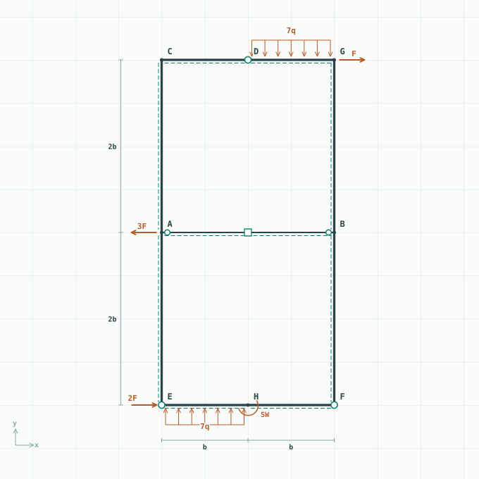
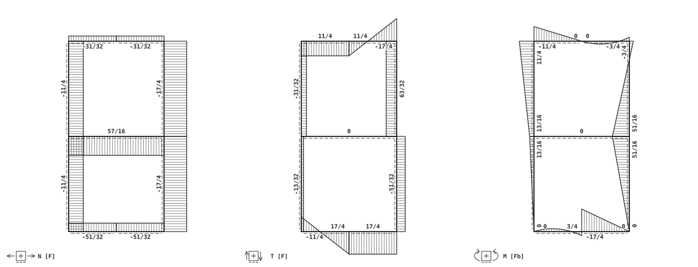

[🇮🇹 Italiano](README.md) · **🇬🇧 English**

# 1 · Free frame with bar AB

At start-up the editor shows this exam. Alternatively choose **Open** and load [modello.json](modello.json). The aim is to find the force in the pin-ended bar AB and the diagrams of the frame, using as unknown the couple $W_{AE}$ transmitted by node A to member AE.

## 1. Check equilibrium before the release

The frame is $2b$ wide and $4b$ high. A uniform load acts downwards on DG and one acts upwards on EH, both of intensity $7q$ and length $b$. An anticlockwise couple $5W=5Fb$ acts at H. The bar has a thermal elongation $\varepsilon_{AB}=-b^2F/EJ$ and the elastic axial deformability is neglected.

The frame has no supports. The horizontal forces give $2F-3F+F=0$ and the two vertical loads have opposite resultants. For the moments about E, positive if anticlockwise:

$$
(3F)(2b)-F(4b)-(7F)(3b/2)+(7F)(b/2)+5Fb=0.
$$

The loads are therefore self-equilibrated. The solver blocks the three rigid-body motions with auxiliary supports, which turn out to be unloaded.

## 2. Build the primary and the unit-load structure

The frame has a single redundant unknown. Insert a hinge at end A of member AE and call $X=W_{AE}$ the anticlockwise couple that node A applies to that end. The opposite couple acts on the node.

- **Primary.** Set $X=0$ and solve equilibrium with the given loads. AB carries axial force only and the moment vanishes at the hinges D, E, F and at the released end.
- **Unit load.** Remove the loads and apply the unit couple at the release. $M_x$ is the moment and $N_x$ the axial force for $X=1$.

In the **Virtual work** tab you find the calculation scheme, the two diagrams and the virtual work table. The table below lists the rows of that table, with $\xi=x/b$ measured from the first letter of the member.

| Member | $L/b$ | $M_o/(Fb)$ | $M_x$ |
| --- | ---: | --- | --- |
| AB | 2 | 0 | 0 |
| CD | 1 | $-11/4+11\xi/4$ | 0 |
| AE | 2 | 0 | $-1+\xi/2$ |
| CA | 2 | $11/4-11\xi/8$ | $-\xi/2$ |
| BF | 2 | $4-2\xi$ | $1-\xi/2$ |
| GB | 2 | $-3/4+19\xi/8$ | $\xi/2$ |
| HF | 1 | $-17/4+17\xi/4$ | 0 |
| DG | 1 | $11\xi/4-7\xi^2/2$ | 0 |
| EH | 1 | $-11\xi/4+7\xi^2/2$ | 0 |

For example, on DG the equilibrium of a segment gives $M_o=(11F/4)x-(7q/2)x^2$: the first term comes from the shear force at D, the second from the distributed load.

## 3. Impose compatibility at A

The relative rotation at the release must be zero:

$$
\delta_o+f\,X=0,\qquad
\delta_o=\sum\int\frac{M_xM_o}{EJ}\,dx+N_{x,AB}\,\varepsilon_{AB}L_{AB},\qquad
f=\sum\int\frac{M_x^2}{EJ}\,dx.
$$

On CA the product $(-\xi/2)(11/4-11\xi/8)$ integrated between 0 and 2 gives $-11/12$. In the unit-load structure the bar has $N_x=1/b$, so the elongation contributes $(1/b)(-b^2F/EJ)(2b)=-2Fb^2/EJ$.

| Contribution | $\delta_o$ in $Fb^2/EJ$ | $f$ in $b/EJ$ |
| --- | ---: | ---: |
| AE | 0 | 2/3 |
| CA | −11/12 | 2/3 |
| BF | 8/3 | 2/3 |
| GB | 29/12 | 2/3 |
| AB, elongation | −2 | 0 |
| **Total** | **13/6** | **8/3** |

$$
X=W_{AE}=-\frac{13}{16}Fb.
$$

## 4. Rebuild the diagrams and check cross-section H

On each member $M=M_o+XM_x$ and $N=N_o+XN_x$. For the bar $N_{AB}=(35/8-13/16)F=57F/16$, so AB is in tension. The **Reactions** tab shows the members isolated, with the actions of the nodes.

The **Cross-section** tab reads the internal forces at end H of beam HF: $N=-51F/32$, $T=17F/4$ and $M=-17Fb/4$. With $b=480$ mm and $F=1500$ N they become $-2391$ N, $6375$ N and $-3\,060\,000$ N·mm.

| Quantity | Value |
| --- | ---: |
| $A$ | 1183 mm² |
| $y_g$ | 38.98 mm |
| $J_u$ | 549 474 mm⁴ |
| $S^*$ at the point at $y=15$ mm | 9573 mm³ |
| $\sigma_m$ at the lower edge | −219.1 N/mm² |
| $\sigma_c$, $\tau_c$ at point * | −135.6 and 15.87 N/mm² |
| von Mises at point * | 138.3 N/mm² |

**Check with another unknown.** In **Whole model → Unknown to release** choose N_AB and press **Solve** again. Now $X=N_{AB}=57F/16$. The primary and the unit-load structure change, the final diagrams stay the same.

[Tutorial index](../README.en.md)
