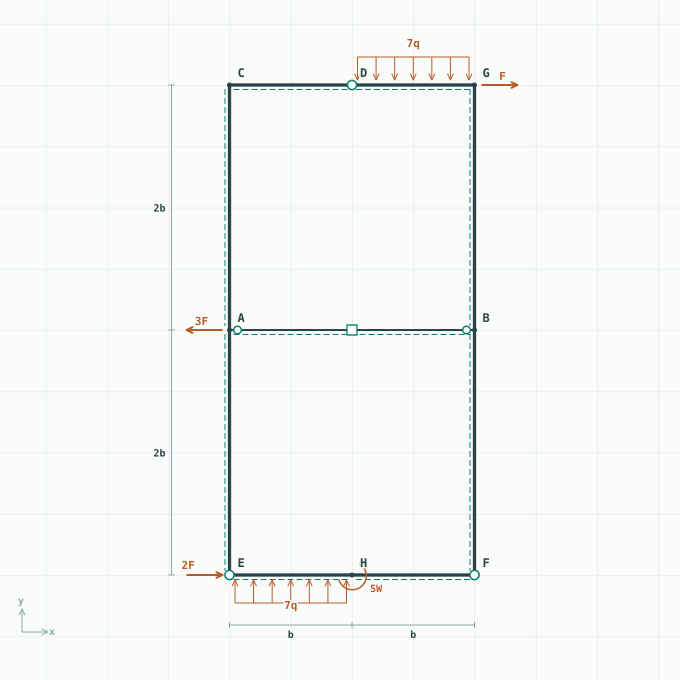
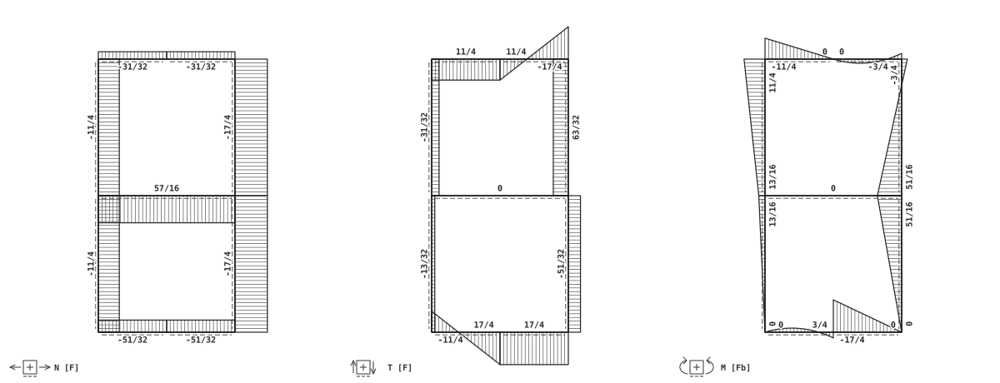

**🇮🇹 Italiano** · [🇬🇧 English](README.en.md)

# 1 · Telaio libero con biella AB

All’avvio l’editor mostra questo tema. In alternativa scegli **Apri** e carica [modello.json](modello.json). Lo scopo è trovare lo sforzo nella biella AB e i diagrammi del telaio usando come incognita la coppia $W_{AE}$ trasmessa dal nodo A all’asta AE.

## 1. Controlla l’equilibrio prima del rilascio

Il telaio ha larghezza $2b$ e altezza $4b$. Su DG agisce un carico uniforme verso il basso e su EH uno verso l’alto, entrambi di intensità $7q$ e lunghezza $b$. In H agisce una coppia antioraria $5W=5Fb$. La biella ha un’elongazione termica $\varepsilon_{AB}=-b^2F/EJ$ e si trascura la deformabilità assiale elastica.

Il telaio non ha vincoli a terra. Le forze orizzontali danno $2F-3F+F=0$ e i due carichi verticali hanno risultanti opposte. Per i momenti rispetto a E, positivi se antiorari:

$$
(3F)(2b)-F(4b)-(7F)(3b/2)+(7F)(b/2)+5Fb=0.
$$

I carichi sono quindi autoequilibrati. Il solutore blocca i tre moti rigidi con vincoli ausiliari, che risultano scarichi.

## 2. Costruisci principale e servizio

Il telaio ha una sola iperstatica. Inserisci una cerniera all’estremo A dell’asta AE e chiama $X=W_{AE}$ la coppia antioraria che il nodo A applica a quell’estremo. Sul nodo agisce la coppia opposta.

- **Principale.** Poni $X=0$ e risolvi l’equilibrio con i carichi assegnati. AB ha solo sforzo normale e il momento si annulla nelle cerniere D, E, F e nell’estremo rilasciato.
- **Servizio.** Togli i carichi e applica la coppia unitaria al rilascio. $M_x$ è il momento e $N_x$ la normale per $X=1$.

Nella scheda **Lavori virtuali** trovi lo schema di calcolo, i due diagrammi e il quadro dei contributi. La tabella qui sotto riporta le righe del quadro, con $\xi=x/b$ misurata dalla prima lettera dell’asta.

| Asta | $L/b$ | $M_o/(Fb)$ | $M_x$ |
| --- | ---: | --- | --- |
| AB | 2 | 0 | 0 |
| CD | 1 | $-11/4+11\xi/4$ | 0 |
| AE | 2 | 0 | $-1+\xi/2$ |
| CA | 2 | $11/4-11\xi/8$ | $-\xi/2$ |
| BF | 2 | $4-2\xi$ | $1-\xi/2$ |
| GB | 2 | $-3/4+19\xi/8$ | $\xi/2$ |
| HF | 1 | $-17/4+17\xi/4$ | 0 |
| DG | 1 | $11\xi/4-7\xi^2/2$ | 0 |
| EH | 1 | $-11\xi/4+7\xi^2/2$ | 0 |

Per esempio, su DG l’equilibrio di un tratto dà $M_o=(11F/4)x-(7q/2)x^2$: il primo termine viene dal taglio in D, il secondo dal carico distribuito.

## 3. Imponi la congruenza in A

La rotazione relativa al rilascio deve essere nulla:

$$
\delta_o+f\,X=0,\qquad
\delta_o=\sum\int\frac{M_xM_o}{EJ}\,dx+N_{x,AB}\,\varepsilon_{AB}L_{AB},\qquad
f=\sum\int\frac{M_x^2}{EJ}\,dx.
$$

Su CA il prodotto $(-\xi/2)(11/4-11\xi/8)$ integrato fra 0 e 2 dà $-11/12$. Nel servizio la biella ha $N_x=1/b$, quindi l’elongazione contribuisce con $(1/b)(-b^2F/EJ)(2b)=-2Fb^2/EJ$.

| Contributo | $\delta_o$ in $Fb^2/EJ$ | $f$ in $b/EJ$ |
| --- | ---: | ---: |
| AE | 0 | 2/3 |
| CA | −11/12 | 2/3 |
| BF | 8/3 | 2/3 |
| GB | 29/12 | 2/3 |
| AB, elongazione | −2 | 0 |
| **Totale** | **13/6** | **8/3** |

$$
X=W_{AE}=-\frac{13}{16}Fb.
$$

## 4. Ricostruisci i diagrammi e verifica la sezione H

Su ogni asta $M=M_o+XM_x$ e $N=N_o+XN_x$. Per la biella $N_{AB}=(35/8-13/16)F=57F/16$, quindi AB è tesa. La scheda **Reazioni** mostra le aste isolate con le azioni dei nodi.

La scheda **Sezione** legge le azioni all’estremo H della trave HF: $N=-51F/32$, $T=17F/4$ e $M=-17Fb/4$. Con $b=480$ mm e $F=1500$ N diventano $-2391$ N, $6375$ N e $-3\,060\,000$ N·mm.

| Grandezza | Valore |
| --- | ---: |
| $A$ | 1183 mm² |
| $y_g$ | 38,98 mm |
| $J_u$ | 549 474 mm⁴ |
| $S^*$ nel punto a $y=15$ mm | 9573 mm³ |
| $\sigma_m$ al lembo inferiore | −219,1 N/mm² |
| $\sigma_c$, $\tau_c$ nel punto * | −135,6 e 15,87 N/mm² |
| von Mises nel punto * | 138,3 N/mm² |

**Controllo con un’altra incognita.** In **Modello completo → Incognita da rilasciare** scegli N_AB e premi di nuovo **Calcola**. Ora $X=N_{AB}=57F/16$. Principale e servizio cambiano, i diagrammi finali restano gli stessi.

[Indice dei tutorial](../README.md)
