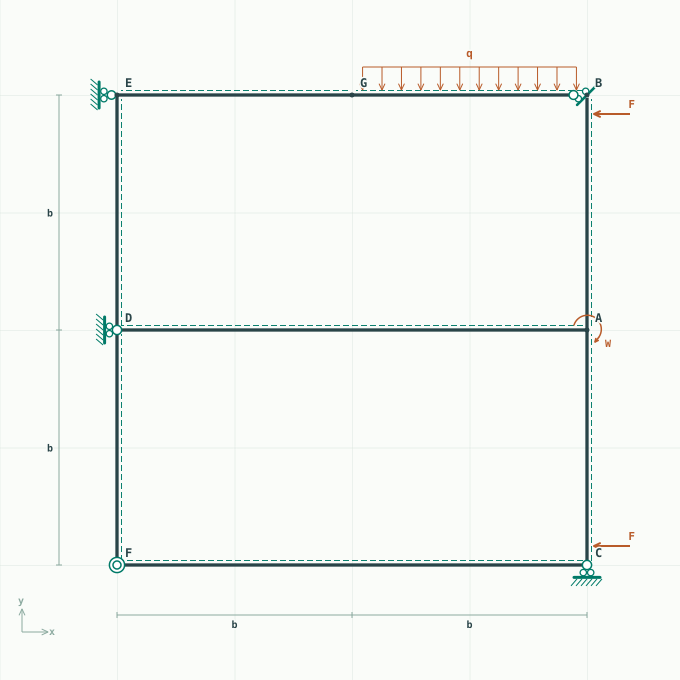
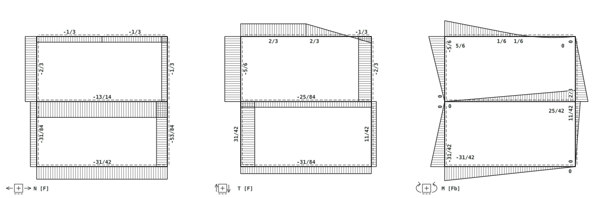

[🇮🇹 Italiano](README.md) · **🇬🇧 English**

# 2 · Inclined roller and rotational spring

Choose **Models → Exam 2** or open [modello.json](modello.json). The unknown is the couple $W_{FD}$ transmitted by the rotational spring at F. The exam uses an internal roller on an inclined plane and two forces applied on one side of the node only.

## 1. How it is entered in the editor

- **Internal roller at B.** Select member BG. The connection at B is **Roller · inclined plane** with Δx = 1 and Δy = 1, that is the 1:1 plane of the exam sheet. The roller transmits only a force perpendicular to the plane, with components of equal magnitude and opposite sign.
- **Spring at F.** Member FD has at F a rotational spring of stiffness 3, that is $k=3EJ/b$. On the drawing board it appears as a double circle.
- **Forces on one side.** $H_{BA}=-F$ is entered in **Loads on one side of the node** of member AB, at end B: it acts on AB, below the roller. $H_{CA}=-F$ is entered in the same way on member CA at C.
- **Hinges.** At D and at C all the members are hinged. At E the circle belongs to the roller on the ground and the corner stays rigid.

The other data are the couple $-W$ at A, the load $-q$ on BG and the elongation $\varepsilon_{CA}=-b^2F/EJ$.

## 2. Primary and unit-load structure

Disconnect the spring at F, leaving a hinge. The **Virtual work** tab shows the calculation scheme with the two couples $X$, the diagram $M_o$ of the given loads and $M_x$ for $X=1$. With $\xi=x/b$ from the first letter:

| Member | $L/b$ | $M_o/(Fb)$ | $M_x$ |
| --- | ---: | --- | --- |
| AB | 1 | $2/3-2\xi/3$ | 0 |
| CA | 1 | $\xi$ | $-\xi$ |
| DE | 1 | $-5\xi/6$ | 0 |
| FD | 1 | 0 | $-1+\xi$ |
| GE | 1 | $1/6+2\xi/3$ | 0 |
| BG | 1 | $-\xi/3+\xi^2/2$ | 0 |
| AD | 2 | $4/3-2\xi/3$ | $-1+\xi/2$ |
| CF | 2 | 0 | $-\xi/2$ |

## 3. The virtual work, including the spring

On segment CA the unit-load structure gives $N_x=1/(2b)$ and the elongation produces $N_x\varepsilon_{CA}b=-Fb^2/(2EJ)$. The spring adds $1/k=b/(3EJ)$ to the flexibility, because in the unit-load structure it transmits a unit couple.

| Contribution | $\delta_o$ in $Fb^2/EJ$ | $f$ in $b/EJ$ |
| --- | ---: | ---: |
| CA | −1/3 | 1/3 |
| FD | 0 | 1/3 |
| AD | −8/9 | 2/3 |
| CF | 0 | 2/3 |
| CA, elongation | −1/2 | 0 |
| FD, spring | 0 | 1/3 |
| **Total** | **−31/18** | **7/3** |

$$
X=W_{FD}=\frac{31}{42}Fb.
$$

## 4. Final diagrams

| Member | $N/F$ | $M(0)/(Fb)$ | $M(L)/(Fb)$ |
| --- | ---: | ---: | ---: |
| AB | −1/3 | 2/3 | 0 |
| CA | −53/84 | 0 | 11/42 |
| DE | −2/3 | 0 | −5/6 |
| FD | −31/84 | −31/42 | 0 |
| GE | −1/3 | 1/6 | 5/6 |
| BG | −1/3 | 0 | 1/6 |
| AD | −13/14 | 25/42 | 0 |
| CF | −31/42 | 0 | −31/42 |

On BG the moment has an interior minimum $-Fb/18$ at $x=b/3$ and passes through zero at $x=2b/3$.

## 5. Cross-section E of beam DE

The cross-section has a foot of 24 × 12 mm, a web 12 mm wide up to height 35, a flange 48 mm wide up to height 48 and a triangular part that closes at height 54. In the profile of the editor the triangle is the final row `54  0` after `48  48`.

With $b=510$ mm and $F=5610$ N the internal forces at E are $N=-3740$ N, $T=-4675$ N and $M=-2\,384\,250$ N·mm.

| Quantity | Value |
| --- | ---: |
| $A$ | 1332 mm² |
| $y_g$ | 31.01 mm |
| $J_u$ | 341 004 mm⁴ |
| $S^*$ at the point at $y=13$ mm | 7426 mm³ |
| $\sigma_m$ at the lower edge | −219.6 N/mm² |
| $\sigma_c$, $\tau_c$ at point * | −128.8 and 8.484 N/mm² |
| von Mises at point * | 129.6 N/mm² |

[Tutorial index](../README.en.md)
