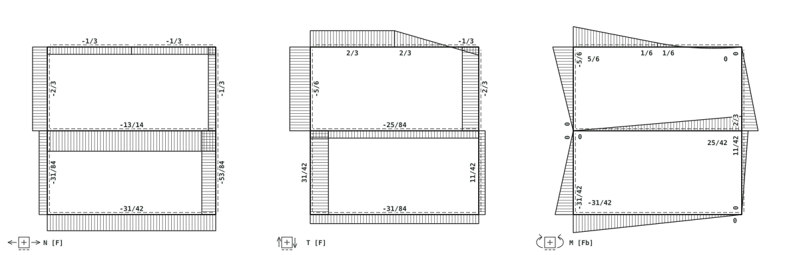

# 2 · Telaio con molla rotazionale in F

In questo tema l’incognita è la coppia trasmessa da una molla fra due aste. Lo svolgimento è analitico. Il collegamento interno in B permette lo scorrimento su un piano inclinato a 45°, una condizione che l’editor attuale non rappresenta.

## 1. Ricostruisci lo schema

Disegna un quadrato di lato $2b$. La traversa DA divide il telaio a metà altezza. Le dimensioni si leggono dalle coordinate espresse in unità di $b$.

| Quota | Sinistra | Mezzeria | Destra |
| --- | --- | --- | --- |
| $y=2b$ | E | G | B |
| $y=b$ | D | | A |
| $y=0$ | F | | C |
| Ascissa | $x=0$ | $x=b$ | $x=2b$ |

Gli appoggi in E e D reagiscono orizzontalmente, quello in C verticalmente. Sul lato destro i montanti AB e CA sono collegati alla traversa in A. La traversa AD è incernierata in D. In F il collegamento tra FD e CF ha rigidezza rotazionale $k=3EJ/b$. In B il carrello interno trasmette una forza perpendicolare al piano di scorrimento. Le componenti di questa forza hanno lo stesso modulo e segno opposto lungo gli assi globali.

Applica una forza orizzontale $-F$ in B sul lato BA e una $-F$ in C sul lato CA, una coppia oraria $Fb$ in A e un carico uniforme verticale verso il basso $q=F/b$ sul solo tratto BG. Su CA è assegnata $\varepsilon_{CA}=-b^2F/EJ$. Tutti i tratti hanno lo stesso $EJ$ e si trascura la deformabilità assiale elastica. I riferimenti numerici sono $F=5{,}61$ kN e $b=0{,}510$ m.

## 2. Rilascia la molla e risolvi i due schemi

Scollega la molla in F e conserva la cerniera che trasmette le forze. La **principale** porta i carichi reali e ha momento nullo al rilascio. Nel **servizio** applica due coppie unitarie opposte sulle facce del rilascio. Scegli come $X$ positiva la coppia antioraria applicata su FD in F. Con questo verso il momento locale del servizio su FD parte da $-1$ in F e si annulla in D.

La tabella raccoglie i campi ottenuti dall’equilibrio. Su ogni riga misura $\xi=s/b$ partendo dalla prima lettera. $m_1$ è il momento per unità di coppia applicata. Per esempio, da F a D non c’è carico distribuito, quindi la retta che unisce $-1$ e 0 è $m_1=-1+\xi$. Su BG il taglio varia linearmente sotto il carico distribuito e il momento è parabolico.

| Tratto | $L/b$ | $M_0/(Fb)$ | $m_1$ |
| --- | ---: | --- | --- |
| AB | 1 | $2/3-2\xi/3$ | 0 |
| CA | 1 | $\xi$ | $-\xi$ |
| DE | 1 | $-5\xi/6$ | 0 |
| FD | 1 | 0 | $-1+\xi$ |
| GE | 1 | $1/6+2\xi/3$ | 0 |
| BG | 1 | $-\xi/3+\xi^2/2$ | 0 |
| AD | 2 | $4/3-2\xi/3$ | $-1+\xi/2$ |
| CF | 2 | 0 | $-\xi/2$ |

## 3. Scrivi il lavoro virtuale, compresa la molla

Sul tratto CA il servizio dà $n_1=1/(2b)$. La deformazione impressa produce quindi $n_1\varepsilon_{CA}b=-Fb^2/(2EJ)$. La molla aggiunge $1/k=b/(3EJ)$ alla flessibilità, perché il suo momento nel servizio ha modulo unitario.

$$
\delta_{10}=\sum_e\int_e m_1M_0/(EJ)\,ds+n_{1,CA}\varepsilon_{CA}b,
\qquad
f_{11}=\sum_e\int_e m_1^2/(EJ)\,ds+1/k.
$$

| Contributo | $\delta_{10}$ in unità $Fb^2/EJ$ | $f_{11}$ in unità $b/EJ$ |
| --- | ---: | ---: |
| CA, flessione | −1/3 | 1/3 |
| FD, flessione | 0 | 1/3 |
| AD, flessione | −8/9 | 2/3 |
| CF, flessione | 0 | 2/3 |
| CA, deformazione impressa | −1/2 | 0 |
| Molla in F | 0 | 1/3 |
| **Totale** | **−31/18** | **7/3** |

La congruenza $\delta_{10}+Xf_{11}=0$ dà

$$
X=\frac{31}{42}Fb\simeq 2{,}112\ \mathrm{kN\,m}.
$$

## 4. Traccia normale, taglio e momento finali

Per il momento usa $M/(Fb)=M_0/(Fb)+(31/42)m_1$. La colonna del taglio si ottiene derivando questa espressione rispetto a $\xi$. La normale è costante su ogni tratto.

| Tratto | $N/F$ | $T/F$ | $M(0)/(Fb)$ | $M(L)/(Fb)$ |
| --- | ---: | --- | ---: | ---: |
| AB | −1/3 | −2/3 | 2/3 | 0 |
| CA | −53/84 | 11/42 | 0 | 11/42 |
| DE | −2/3 | −5/6 | 0 | −5/6 |
| FD | −31/84 | 31/42 | −31/42 | 0 |
| GE | −1/3 | 2/3 | 1/6 | 5/6 |
| BG | −1/3 | $-1/3+\xi$ | 0 | 1/6 |
| AD | −13/14 | −25/84 | 25/42 | 0 |
| CF | −31/42 | −31/84 | 0 | −31/42 |

Su BG segna anche il minimo interno $M=-Fb/18$ a $s=b/3$ e il passaggio per zero a $s=2b/3$. Unire le sole ordinate di B e G con una retta farebbe perdere il cambio di lembo teso.

## 5. Verifica la sezione E dell’asta DE

Leggi la riga DE a $s=b$. Ottieni $N=-3740$ N, $T=-4675$ N e $M=-2\,384\,250$ N·mm. La sezione ha un piede di 24 × 12 mm, un’anima centrale larga 12 mm da quota 12 a 35 mm e un’ala larga 48 mm da quota 35 a 48 mm. Sopra l’ala c’è un triangolo di base 48 mm e altezza 6 mm. Le quote partono dal fondo.

La somma delle quattro aree dà $A=1332$ mm². Dai momenti statici e dal trasporto dei momenti d’inerzia ottieni $y_g=31{,}01$ mm e $J_x=341004$ mm⁴. Nel punto assegnato a $y=13$ mm usa $Q=7426$ mm³ e lo spessore dell’anima $t=12$ mm.

Con $\sigma=N/A-M(y-y_g)/J_x$ ottieni $\sigma_*=-128{,}8$ MPa. Il modulo del taglio è $|\tau_*|=|T|Q/(J_x t)=8{,}484$ MPa e la tensione equivalente è $\sqrt{\sigma_*^2+3\tau_*^2}=129{,}6$ MPa. La tensione normale di massimo valore assoluto è **−219,6 MPa** al lembo inferiore.

[Indice dei tutorial](../README.md)
