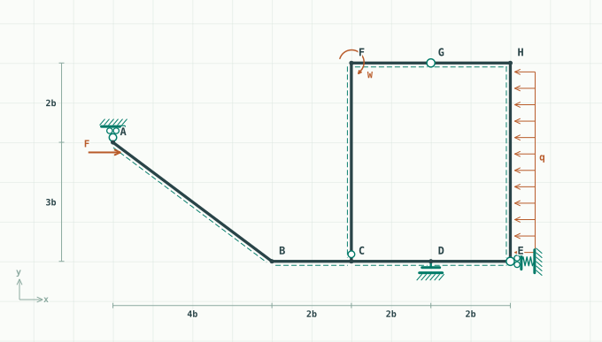
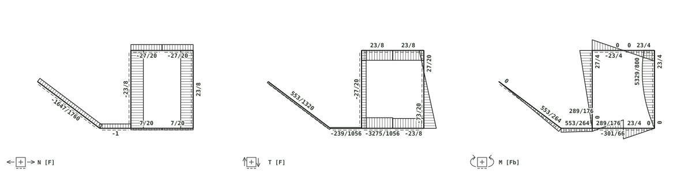

[🇮🇹 Italiano](README.md) · **🇬🇧 English**

# 8 · Double pendulum and translational spring

Choose **Models → Exam 8** or open [modello.json](modello.json). The unknown assigned by the exam sheet is $X=W_{BC}$, the couple transmitted by node B to member BC.

## 1. How it is entered in the editor

- **Double pendulum at D.** Node D has the support **Double pendulum · slides horizontally**: it reacts with a vertical force and with a couple.
- **Translational spring at E.** Node E is a roller with a horizontal reaction. In **Support springs and settlements** the horizontal stiffness is 4, that is $k_E=4EJ/b^3$.
- **Inclined member.** AB goes from A(0, 3b) to B(4b, 0) and is $5b$ long. The thermal curvature $\theta_{AB}=-bF/EJ$ is the value −1 in the θ field.
- **Force on one side.** $H_{AB}=F$ is applied at end A of member AB.
- **Hinges.** FC is hinged at C, the top beam has a hinge at G and two hinged members meet at E.

## 2. The virtual work table

In the unit-load structure $M_x$ is different from zero only on AB, BC and CD. The thermal curvature enters the column $\int M_x\theta\,dx$.

| Member | $M_x$ | $\int M_xM_o/EJ$ | $\int M_x\theta$ | $\int M_x^2/EJ$ |
| --- | --- | ---: | ---: | ---: |
| AB | $-\xi/5$ | 0 | 5/2 | 5/3 |
| BC | $-1-\xi/4$ | 2 | 0 | 19/6 |
| CD | $-3/2-\xi/4$ | 445/24 | 0 | 37/6 |
| **Total** | | **553/24** | | **11** |

The known terms are in $Fb^2/EJ$ and the flexibility in $b/EJ$.

$$
X=W_{BC}=-\frac{553}{264}Fb.
$$

The roller at E is the only horizontal support: its reaction follows from equilibrium alone and is zero in the unit-load structure, so the spring does not enter the equation. In the final structure the reaction $H_E=4F$ compresses the spring, which shortens by $H_E/k_E=Fb^3/EJ$.

## 3. Results to compare

| Member | $N/F$ | $M(0)/(Fb)$ | $M(L)/(Fb)$ |
| --- | ---: | ---: | ---: |
| AB | −1647/1760 | 0 | 553/264 |
| BC | −1 | 553/264 | 289/176 |
| CD | 7/20 | 289/176 | −301/66 |
| DE | 7/20 | 23/4 | 0 |
| FC | −23/8 | 27/4 | 0 |
| FG | −27/20 | −23/4 | 0 |
| GH | −27/20 | 0 | 23/4 |
| HE | 23/8 | 23/4 | 0 |

In cross-section H of beam GH, with $b=250$ mm and $F=1240$ N, the maximum normal stress is $-209.3$ N/mm² at the upper edge. At the point at height 40 mm you find $\sigma_c=-127.9$, $\tau_c=12.49$ and a von Mises stress of $129.7$ N/mm².

[Tutorial index](../README.en.md)
