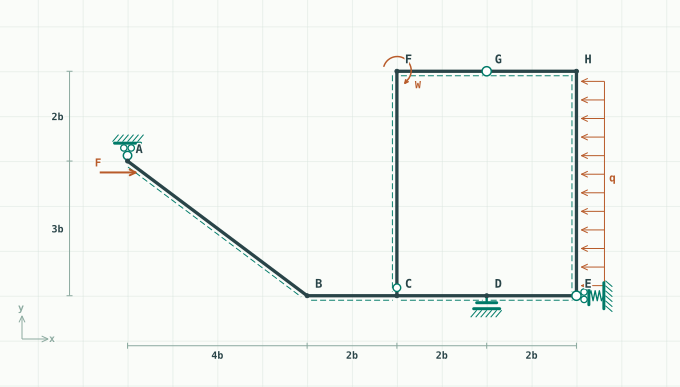
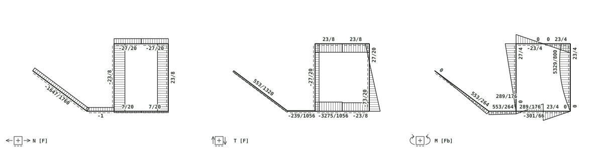

**🇮🇹 Italiano** · [🇬🇧 English](README.en.md)

# 8 · Doppio pendolo e molla traslazionale

Scegli **Modelli → Tema 8** oppure apri [modello.json](modello.json). L’incognita assegnata dalla traccia è $X=W_{BC}$, la coppia trasmessa dal nodo B all’asta BC.

## 1. Come è inserito nell’editor

- **Doppio pendolo in D.** Il nodo D ha il vincolo **Doppio pendolo · scorre in orizzontale**: reagisce con una forza verticale e con una coppia.
- **Molla traslazionale in E.** Il nodo E è un carrello con reazione orizzontale. In **Molle e cedimenti del vincolo** la rigidezza orizzontale vale 4, cioè $k_E=4EJ/b^3$.
- **Asta inclinata.** AB va da A(0, 3b) a B(4b, 0) ed è lunga $5b$. La curvatura termica $\theta_{AB}=-bF/EJ$ è il valore −1 nel campo θ.
- **Forza su un lato.** $H_{AB}=F$ è applicata all’estremo A dell’asta AB.
- **Cerniere.** FC è incernierata in C, il traverso superiore ha una cerniera in G e in E si incontrano due aste incernierate.

## 2. Il quadro dei lavori virtuali

Nel servizio $M_x$ è diverso da zero solo su AB, BC e CD. La curvatura termica entra nella colonna $\int M_x\theta\,dx$.

| Asta | $M_x$ | $\int M_xM_o/EJ$ | $\int M_x\theta$ | $\int M_x^2/EJ$ |
| --- | --- | ---: | ---: | ---: |
| AB | $-\xi/5$ | 0 | 5/2 | 5/3 |
| BC | $-1-\xi/4$ | 2 | 0 | 19/6 |
| CD | $-3/2-\xi/4$ | 445/24 | 0 | 37/6 |
| **Totale** | | **553/24** | | **11** |

I termini noti sono in $Fb^2/EJ$ e la flessibilità in $b/EJ$.

$$
X=W_{BC}=-\frac{553}{264}Fb.
$$

Il carrello in E è l’unico vincolo orizzontale: la sua reazione segue dal solo equilibrio e nel servizio è nulla, quindi la molla non entra nell’equazione. Nella struttura finale la reazione $H_E=4F$ comprime la molla, che si accorcia di $H_E/k_E=Fb^3/EJ$.

## 3. Risultati da confrontare

| Asta | $N/F$ | $M(0)/(Fb)$ | $M(L)/(Fb)$ |
| --- | ---: | ---: | ---: |
| AB | −1647/1760 | 0 | 553/264 |
| BC | −1 | 553/264 | 289/176 |
| CD | 7/20 | 289/176 | −301/66 |
| DE | 7/20 | 23/4 | 0 |
| FC | −23/8 | 27/4 | 0 |
| FG | −27/20 | −23/4 | 0 |
| GH | −27/20 | 0 | 23/4 |
| HE | 23/8 | 23/4 | 0 |

Nella sezione H della trave GH, con $b=250$ mm e $F=1240$ N, la tensione normale massima è $-209{,}3$ N/mm² al lembo superiore. Nel punto a quota 40 mm si trovano $\sigma_c=-127{,}9$, $\tau_c=12{,}49$ e una tensione di von Mises di $129{,}7$ N/mm².

[Indice dei tutorial](../README.md)
