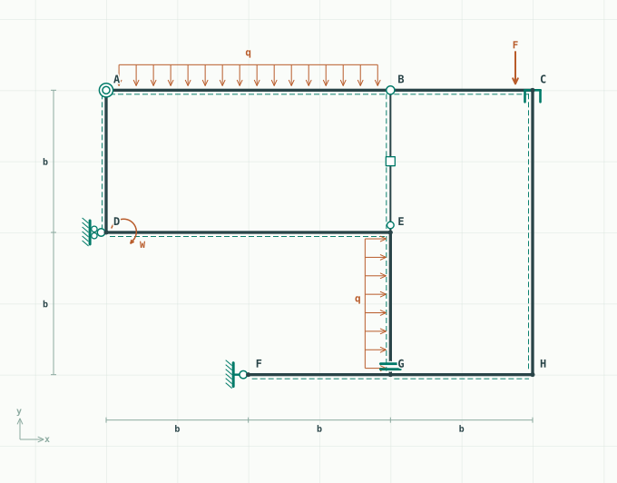
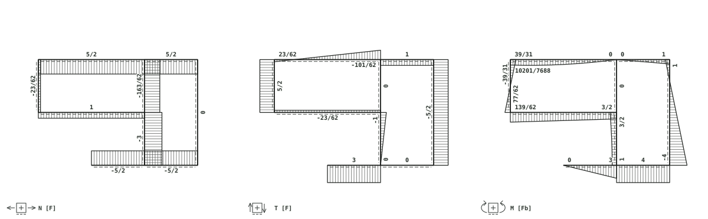

[🇮🇹 Italiano](README.md) · **🇬🇧 English**

# 11 · Internal sliders and load on one side

Choose **Models → Exam 11** or open [modello.json](modello.json). The unknown is $X=W_{AD}$, the couple transmitted by node A to member AD through the rotational spring.

## 1. How it is entered in the editor

- **Slider at C.** Member CH has at C the connection **Slider · slides along the member**. It transmits a couple and a horizontal force, and leaves the vertical sliding free. On the drawing board it is the U-shaped sleeve on top of the column.
- **Slider at G.** Member EG has at G the connection **Slider · slides across the member**. It transmits a couple and a vertical force, not the shear force.
- **Loads on one side.** $V_{CB}=-F$ is applied at end C of member BC and $W_{DE}=-W$ at end D of member DE.
- **Spring at A.** Member AB has at A a rotational spring of stiffness 4, that is $k_{AB}=4EJ/b$.
- **Bar BE.** It has the thermal elongation $\varepsilon_{BE}=-b^2F/EJ$. At B all the members are hinged.

## 2. What changes with the sliders

The slider at C transmits no vertical force: the load $V_{CB}$ stays on member BC and the column CH has zero axial force. The slider at G cancels the shear force of EG at G: under the load $q$ the shear force goes from $-F$ at E to zero at G. Both sliders transmit the couple, so the bending moment diagram is continuous across them.

## 3. The virtual work table

| Contribution | $\delta_o$ in $Fb^2/EJ$ | $f$ in $b/EJ$ |
| --- | ---: | ---: |
| AB | 1/3 | 2/3 |
| DE | −17/6 | 2/3 |
| AD | −5/4 | 1 |
| AB, spring | 0 | 1/4 |
| BE, elongation | 1/2 | 0 |
| **Total** | **−13/4** | **31/12** |

$$
X=W_{AD}=\frac{39}{31}Fb.
$$

## 4. Results to compare

| Member | $N/F$ | $M(0)/(Fb)$ | $M(L)/(Fb)$ |
| --- | ---: | ---: | ---: |
| AB | 5/2 | 39/31 | 0 |
| BC | 5/2 | 0 | 1 |
| DE | 1 | 139/62 | 3/2 |
| FG | −5/2 | 0 | 3 |
| GH | −5/2 | 4 | 4 |
| AD | −23/62 | −39/31 | 77/62 |
| BE | −163/62 | 0 | 0 |
| CH | 0 | 1 | −4 |
| EG | −3 | 3/2 | 1 |

In cross-section H of beam CH, with $b=420$ mm and $F=780$ N, the axial force is zero and the maximum stress is $-209.2$ N/mm² at the lower edge. At the point at height 9 mm you find $\sigma_c=-149.7$, $\tau_c=5.271$ and a von Mises stress of $150.0$ N/mm².

[Tutorial index](../README.en.md)
