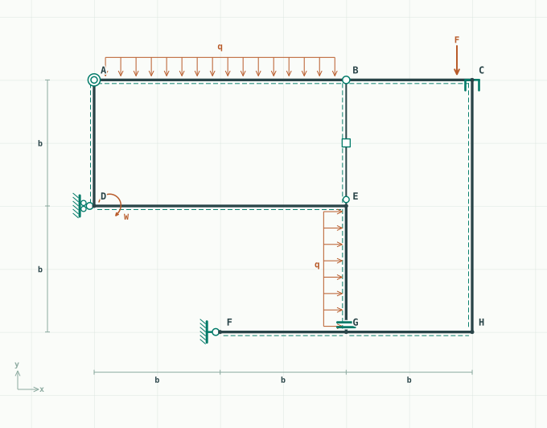
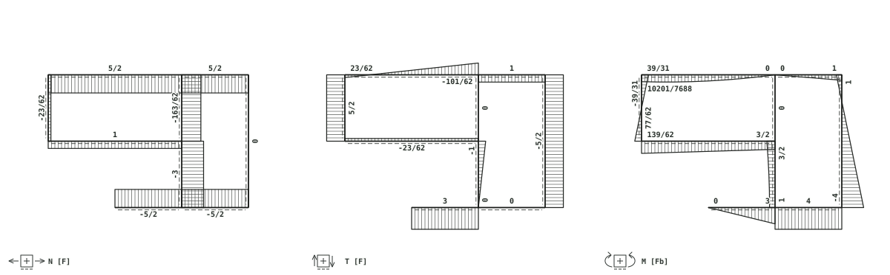

# 11 · Pattini interni e carico su un lato

Scegli **Modelli → Tema 11** oppure apri [modello.json](modello.json). L’incognita è $X=W_{AD}$, la coppia trasmessa dal nodo A all’asta AD attraverso la molla rotazionale.

## 1. Come è inserito nell’editor

- **Pattino in C.** L’asta CH ha in C il collegamento **Pattino · scorre lungo l’asta**. Trasmette coppia e forza orizzontale, lascia libero lo scorrimento verticale. Sulla tavola è il manicotto a U sopra il montante.
- **Pattino in G.** L’asta EG ha in G il collegamento **Pattino · scorre di traverso all’asta**. Trasmette coppia e forza verticale, non il taglio.
- **Carichi su un lato.** $V_{CB}=-F$ è applicata all’estremo C dell’asta BC e $W_{DE}=-W$ all’estremo D dell’asta DE.
- **Molla in A.** L’asta AB ha in A una molla rotazionale di rigidezza 4, cioè $k_{AB}=4EJ/b$.
- **Biella BE.** Ha l’elongazione termica $\varepsilon_{BE}=-b^2F/EJ$. In B tutte le aste sono incernierate.

## 2. Che cosa cambia con i pattini

Il pattino in C non trasmette forza verticale: il carico $V_{CB}$ resta sull’asta BC e il montante CH ha sforzo normale nullo. Il pattino in G annulla il taglio di EG in G: sotto il carico $q$ il taglio passa da $-F$ in E a zero in G. Entrambi i pattini trasmettono la coppia, quindi il diagramma del momento è continuo attraverso di essi.

## 3. Il quadro dei lavori virtuali

| Contributo | $\delta_o$ in $Fb^2/EJ$ | $f$ in $b/EJ$ |
| --- | ---: | ---: |
| AB | 1/3 | 2/3 |
| DE | −17/6 | 2/3 |
| AD | −5/4 | 1 |
| AB, molla | 0 | 1/4 |
| BE, elongazione | 1/2 | 0 |
| **Totale** | **−13/4** | **31/12** |

$$
X=W_{AD}=\frac{39}{31}Fb.
$$

## 4. Risultati da confrontare

| Asta | $N/F$ | $M(0)/(Fb)$ | $M(L)/(Fb)$ |
| --- | ---: | ---: | ---: |
| AB | 5/2 | 39/31 | 0 |
| BC | 5/2 | 0 | 1 |
| DE | 1 | 139/62 | 3/2 |
| FG | −5/2 | 0 | 3 |
| GH | −5/2 | 4 | 4 |
| AD | −23/62 | −39/31 | 77/62 |
| BE | −163/62 | 0 | 0 |
| CH | 0 | 1 | −4 |
| EG | −3 | 3/2 | 1 |

Nella sezione H della trave CH, con $b=420$ mm e $F=780$ N, lo sforzo normale è nullo e la tensione massima vale $-209{,}2$ N/mm² al lembo inferiore. Nel punto a quota 9 mm si trovano $\sigma_c=-149{,}7$, $\tau_c=5{,}271$ e una tensione di von Mises di $150{,}0$ N/mm².

[Indice dei tutorial](../README.md)
