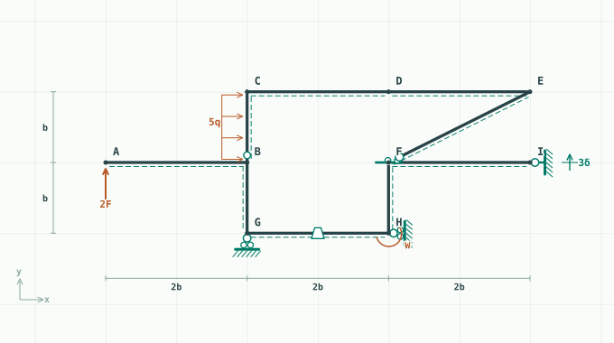
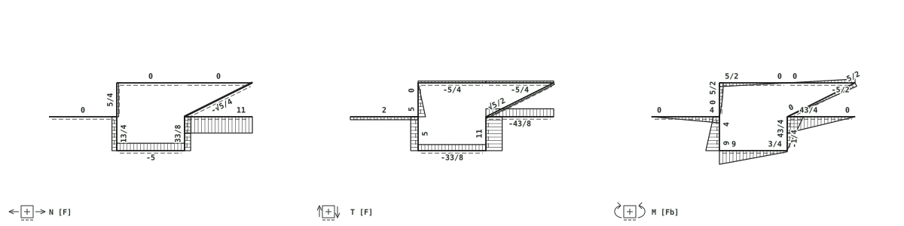

[🇮🇹 Italiano](README.md) · **🇬🇧 English**

# 13 · Imposed settlement and inclined member

Choose **Models → Exam 13** or open [modello.json](modello.json). The assigned unknown is a force: $X=V_G$, the reaction of the roller at G.

## 1. How it is entered in the editor

- **Settlement at I.** Node I is a pinned support. In **Support springs and settlements** the vertical displacement is 3, that is $v_I=3b^3F/EJ$ upwards. On the drawing board the arrow labelled 3δ appears.
- **Internal roller at F.** Member FE has at F the connection **Roller · inclined plane** with Δx = 1 and Δy = 0: it slides horizontally on beam FI and transmits only a vertical force to it.
- **Inclined member.** FE goes from F(4b, b) to E(6b, 2b) and is $\sqrt5\,b$ long. Its results appear with the root: $N=-\sqrt5F/4$ and $T=\sqrt5F/2$.
- **Other data.** The force $2F$ at A, the couple $W$ at H, the load $p=5q$ on member BC, hinged at B, and the thermal curvature $\theta_{GH}=4bF/EJ$.

## 2. The virtual work table

With a force unknown the moments of the unit-load structure are lengths, for example $M_x=x$ on GH, and the integrals are in $Fb^3/EJ$ and $b^3/EJ$. The settlement enters the known term with the work of the virtual reaction on the imposed displacement, with its sign changed. In the unit-load structure $V_I=-1$, so the contribution is $-V_Iv_I=3Fb^3/EJ$.

| Contribution | $\delta_o$ in $Fb^3/EJ$ | $f$ in $b^3/EJ$ |
| --- | ---: | ---: |
| GH, bending | 80/3 | 8/3 |
| GH, thermal curvature | 8 | 0 |
| HF | 37/6 | 4/3 |
| FI | 16/3 | 8/3 |
| I, settlement | 3 | 0 |
| **Total** | **295/6** | **20/3** |

$$
X=V_G=-\frac{59}{8}F.
$$

## 3. Results to compare

| Member | $N/F$ | $M(0)/(Fb)$ | $M(L)/(Fb)$ |
| --- | ---: | ---: | ---: |
| AB | 0 | 0 | 4 |
| BC | 5/4 | 0 | 5/2 |
| CD | 0 | 5/2 | 0 |
| DE | 0 | 0 | −5/2 |
| FE | $-\sqrt5/4$ | 0 | 5/2 |
| BG | 13/4 | 4 | 9 |
| GH | −5 | 9 | 3/4 |
| HF | 33/8 | −1/4 | 43/4 |
| FI | 11 | 43/4 | 0 |

In cross-section G of beam BG, with $b=340$ mm and $F=460$ N, the maximum stress is $205.8$ N/mm² at the lower edge. At the point at height 8 mm you find $\sigma_c=156.0$, $\tau_c=5.954$ and a von Mises stress of $156.3$ N/mm².

[Tutorial index](../README.en.md)
