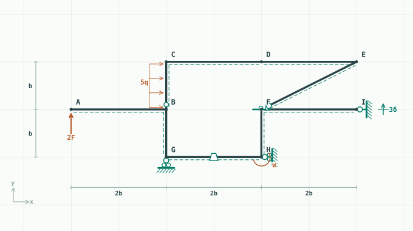
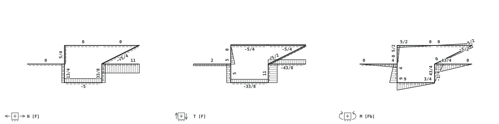

# 13 · Cedimento imposto e asta inclinata

Scegli **Modelli → Tema 13** oppure apri [modello.json](modello.json). L’incognita assegnata è una forza: $X=V_G$, la reazione del carrello in G.

## 1. Come è inserito nell’editor

- **Cedimento in I.** Il nodo I è una cerniera a terra. In **Molle e cedimenti del vincolo** lo spostamento verticale vale 3, cioè $v_I=3b^3F/EJ$ verso l’alto. Sulla tavola compare la freccia con la scritta 3δ.
- **Carrello interno in F.** L’asta FE ha in F il collegamento **Carrello · piano inclinato** con Δx = 1 e Δy = 0: scorre in orizzontale sulla trave FI e le trasmette solo una forza verticale.
- **Asta inclinata.** FE va da F(4b, b) a E(6b, 2b) ed è lunga $\sqrt5\,b$. I suoi risultati compaiono con la radice: $N=-\sqrt5F/4$ e $T=\sqrt5F/2$.
- **Altri dati.** La forza $2F$ in A, la coppia $W$ in H, il carico $p=5q$ sull’asta BC, incernierata in B, e la curvatura termica $\theta_{GH}=4bF/EJ$.

## 2. Il quadro dei lavori virtuali

Con un’incognita forza i momenti del servizio sono lunghezze, per esempio $M_x=x$ su GH, e gli integrali sono in $Fb^3/EJ$ e $b^3/EJ$. Il cedimento entra nel termine noto con il lavoro della reazione virtuale sullo spostamento imposto, cambiato di segno. Nel servizio $V_I=-1$, quindi il contributo vale $-V_Iv_I=3Fb^3/EJ$.

| Contributo | $\delta_o$ in $Fb^3/EJ$ | $f$ in $b^3/EJ$ |
| --- | ---: | ---: |
| GH, flessione | 80/3 | 8/3 |
| GH, curvatura termica | 8 | 0 |
| HF | 37/6 | 4/3 |
| FI | 16/3 | 8/3 |
| I, cedimento | 3 | 0 |
| **Totale** | **295/6** | **20/3** |

$$
X=V_G=-\frac{59}{8}F.
$$

## 3. Risultati da confrontare

| Asta | $N/F$ | $M(0)/(Fb)$ | $M(L)/(Fb)$ |
| --- | ---: | ---: | ---: |
| AB | 0 | 0 | 4 |
| BC | 5/4 | 0 | 5/2 |
| CD | 0 | 5/2 | 0 |
| DE | 0 | 0 | −5/2 |
| FE | $-\sqrt5/4$ | 0 | 5/2 |
| BG | 13/4 | 4 | 9 |
| GH | −5 | 9 | 3/4 |
| HF | 33/8 | −1/4 | 43/4 |
| FI | 11 | 43/4 | 0 |

Nella sezione G della trave BG, con $b=340$ mm e $F=460$ N, la tensione massima vale $205{,}8$ N/mm² al lembo inferiore. Nel punto a quota 8 mm si trovano $\sigma_c=156{,}0$, $\tau_c=5{,}954$ e una tensione di von Mises di $156{,}3$ N/mm².

[Indice dei tutorial](../README.md)
